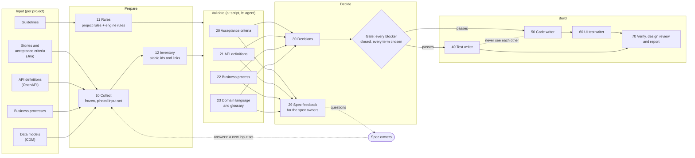

# spec-factory

A pipeline that reads a set of software specifications (user stories with acceptance criteria, API definitions, data models, business processes) the way a builder would, before anything is built. It finds where the specs are incomplete, ambiguous or contradict each other, writes that down as findings with questions for the spec owners, and closes every gap with a recorded decision, so that a separate test writer and code writer build and test the same thing.

**Personal project**, for learning and experiment. It was first applied to the Simpl-Open programme of the European Commission (`simpl-local/simpl-spec-factory`); that instance is a personal test, not commissioned by or speaking for the Commission or its contractors.

## Engine and project

This repository is the **engine**: the steps, their scripts and the briefs for the agents. A **project** is a folder with the data of one programme:

```
<project>/
  project.yaml        issue key prefix, Jira and GitLab addresses, CDM paths, reuse catalogue, API conventions, engine path and pinned commit
  factory             wrapper: ./factory <script> <component> runs the engine script for this project
  guidelines/         the programme's guideline sources, and rules.json from step 11
  cdm/                a frozen snapshot of the data models (step 10) and their inventory (step 12)
  components/<name>/  sources.yaml, build.yaml, specs/, inventory/, validation/, decisions/
```

The scripts find the project through `SPEC_FACTORY_PROJECT` (the wrapper sets it) or the current directory, and read everything programme-specific from `project.yaml` ([`pipeline/project.py`](./pipeline/project.py)). Generated files name the engine commit that made them.

## The pipeline at a glance



Each box in *Validate* has a script part that finds candidates (structure, names, coverage) and an agent part that judges them, triages the script's hits and writes findings with a severity and a question. The test writer and the code writer never see each other's work: they meet only through the specs and the decisions.

## The steps

Each step has a fixed input, a fixed output and, where needed, a gate. Two digits: the phase in the tens, gaps for steps added later. Parts marked *a* are scripts; parts marked *b* run in a fresh agent that knows only its brief and the files it may read.

| No. | Step | Files |
|---|---|---|
| 10 | Collect the input set of a component from its manifest (`sources.yaml`): API and process files at pinned commits, stories from Jira through a local model; a frozen snapshot of the data models | [`collect_specs.py`](./pipeline/collect_specs.py), [`collect_stories.py`](./pipeline/collect_stories.py), [`collect_cdms.py`](./pipeline/collect_cdms.py), [`scan_cdms.py`](./pipeline/scan_cdms.py) |
| 11 | Guidelines to numbered, checkable rules | [`11-guideline-rules.md`](./pipeline/11-guideline-rules.md) |
| 12 | Inventory: a stable id for every story, criterion, operation, process requirement and data model class; links between them | [`12-spec-inventory.md`](./pipeline/12-spec-inventory.md), [`extract_inventory.py`](./pipeline/extract_inventory.py), [`extract_cdm.py`](./pipeline/extract_cdm.py), [`remap_ids.py`](./pipeline/remap_ids.py) |
| 20 | Validate the acceptance criteria: structure and wording (20a); completeness, testability, ambiguity, consistency, correctness, scope and cross-cutting questions (20b) | [`20-validate-acs.md`](./pipeline/20-validate-acs.md), [`check_acs.py`](./pipeline/check_acs.py) |
| 21 | Validate the API definitions against the API rules, and the coverage between operations and stories | [`21-validate-api.md`](./pipeline/21-validate-api.md), [`check_api.py`](./pipeline/check_api.py) |
| 22 | Validate the business process: coverage between process, criteria and operations (22a); order against the decided states, hand-overs between parties, failure paths (22b) | [`22-validate-bp.md`](./pipeline/22-validate-bp.md), [`check_bp.py`](./pipeline/check_bp.py) |
| 23 | Validate the domain language: API against data model against stories, by the DDD, MACH and microservices rules; draft glossary | [`23-validate-domain.md`](./pipeline/23-validate-domain.md), [`check_domain.py`](./pipeline/check_domain.py) |
| 29 | Spec feedback report for the spec owners | [`29-spec-feedback.md`](./pipeline/29-spec-feedback.md), [`build_feedback.py`](./pipeline/build_feedback.py) |
| 30 | Decisions for what 20 to 23 leave open, the gate, and a comparison with an earlier run | [`30-decisions.md`](./pipeline/30-decisions.md), [`check_gate.py`](./pipeline/check_gate.py) |
| 40-60 | Build run in two isolated workspaces: test writer (API) from the specs and decisions, code writer from the same input, then UI browser steps against the running build | [`prepare_run.py`](./pipeline/prepare_run.py), [`40-test-writer.md`](./pipeline/40-test-writer.md), [`50-code-writer.md`](./pipeline/50-code-writer.md), [`60-test-writer-ui.md`](./pipeline/60-test-writer-ui.md) |
| 70 | Verify: results traced to criteria, decisions and rules; load test of the quality targets; independent design review (70c); final report | [`70-verify.md`](./pipeline/70-verify.md), [`verify.py`](./pipeline/verify.py) |

In the briefs, `{ENGINE}` is this repository, `{PROJECT}` the project folder and `{COMPONENT}` the component name.

## Principle: the code is disposable

In spec-driven development the specifications, the decisions, the rules and the tests are what people maintain. The code is generated from them and can be thrown away and generated again. A change starts in a specification or a decision, never in the code.

What this means for the factory:

- **The assets to keep healthy** are the specifications, decisions, glossary, rules and the test suite. Their quality decides the quality of every future build.
- **The build is judged at its boundaries**: the API, the UI, the events, and the quality targets (performance, limits, security, resources). Its internal structure is not judged for its own sake (see [`guidelines/excluded.md`](./guidelines/excluded.md) for why there are no design pattern rules).
- **Regenerating must be cheap and safe**, as cheap as patching. That needs one command for a whole run, a strong suite as the safety net, and repeatable results.

What is not disposable:

- **Stored data** and the way it moves from one version to the next. A new build must read the data of the old one.
- **Published contracts.** A regenerated build keeps the contract, or the change follows the versioning rules (MACH-05, MSV-11).
- **Urgent security fixes.** Until regenerating is as fast as patching, a fix may go into the build first; the specification or decision follows, so the next build keeps it.

## Engine rules

Next to each project's own guidelines, every project gets the engine rules ([`guidelines/rules.md`](./guidelines/rules.md), 177 rules, built by [`guidelines/build_rules.py`](./guidelines/build_rules.py)):

| Prefix | What | Source |
|---|---|---|
| DDD | Domain-driven design: one ubiquitous language, entities in the APIs, boundaries | [`guidelines/ddd.md`](./guidelines/ddd.md) |
| MACH | Microservices, API-first, Cloud-native, Headless | the factory's reading of the MACH Alliance principles |
| MSV | Microservices: boundaries, data ownership, events, resilience, sagas, observability | Lewis and Fowler, Newman, Richardson |
| OWT | OWASP Top 10:2025 as checks on specifications | OWASP (CC BY 3.0); wording the factory's |
| OWA | OWASP API Security Top 10 2023 as checks on specifications | OWASP; wording the factory's |
| REUSE | Reuse first: frameworks, products, standard protocols, named patterns, the project's reuse catalogue | the factory's own; ISO/IEC 25010, Erl, EIF |
| NFR | Quality attributes with measurable targets, tested or measured in step 70 | ISO/IEC 25010:2023 characteristics; Bass, Clements, Kazman; wording the factory's |
| SOA | Service design principles and patterns not covered by MACH and MSV: abstraction, consumer-agnostic contracts, discoverability, composability, autonomy, one contract, canonical data per domain, published policy | Erl (2007, 2009); wording the factory's |
| BLG | Belgif REST API guide, every rule with its own id | [belgif/rest-guide](https://github.com/belgif/rest-guide), Apache 2.0, copy in [`guidelines/sources/belgif/`](./guidelines/sources/belgif/NOTICE.md) |

Steps 20b (cross-cutting questions), 21b (API review), 23b (domain language) and 30a (decisions) use them, the code writer (50) gets every rule tagged for building, and 70c reviews the build against every review rule tagged 70; the briefs name which. Rule sets considered and left out on purpose, such as the Gang of Four patterns, are in [`guidelines/excluded.md`](./guidelines/excluded.md).

## Requirements

Python 3.11 or later with PyYAML. Step 10 reads public GitLab projects without a token and Jira with a personal access token (`JIRA_PAT`); story conversion runs on a local model through Ollama, so story text does not leave the machine. The *b* parts were written for Claude Code agents.

## Writing rules

Everything the factory writes uses plain English and short sentences, without em-dashes or en-dashes. Findings cite ids and judge the specification, never the people who wrote it.
